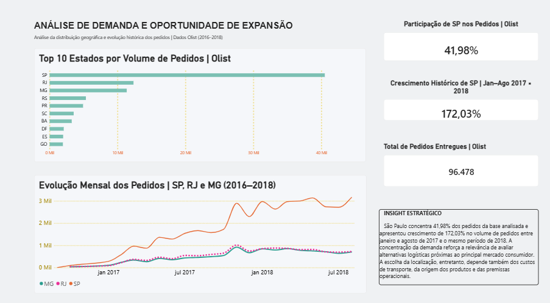
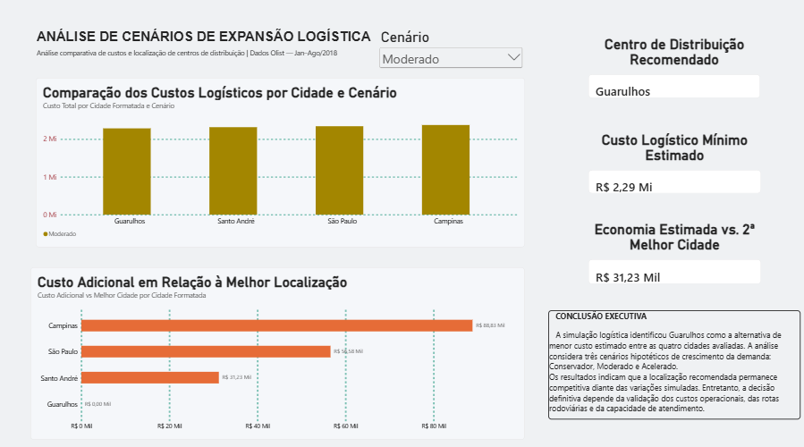
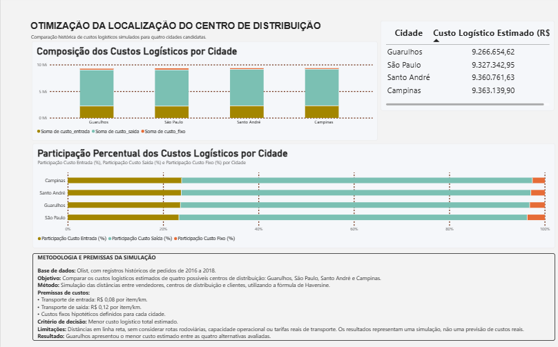

# Otimização Logística e Expansão de E-commerce

### Projeto de Análise de Dados | SQL • Python • Machine Learning • Power BI

## 1. Visão geral

Este projeto analisa dados históricos de um e-commerce brasileiro
para investigar oportunidades de expansão logística e identificar
a localização de menor custo estimado para um centro de distribuição.

A análise utiliza dados públicos da plataforma Olist, referentes
ao período de 2016 a 2018.

O projeto integra análise exploratória, consultas SQL,
avaliação de modelos de Machine Learning, simulação de cenários
e visualização de indicadores em Power BI.

**Pergunta central de negócio:**

> Entre Guarulhos, São Paulo, Santo André e Campinas,
> qual localização apresenta o menor custo logístico estimado
> para a operação analisada?

### Principais resultados

- **Localização recomendada:** Guarulhos (SP), com custo
  logístico histórico simulado de R$ 9,27 milhões.

- **Economia potencial estimada:** R$ 60,69 mil em relação
  à segunda alternativa, São Paulo, nas condições simuladas.

- **Machine Learning:** o modelo baseline apresentou menor
  erro absoluto médio (MAE) que a regressão linear nos
  três estados avaliados (SP, RJ e MG).

- **Análise de cenários:** foram simuladas três hipóteses
  de crescimento da demanda — conservadora, moderada e
  acelerada — para avaliar os impactos nos custos logísticos.

**Conclusão:** Guarulhos apresentou o menor custo estimado
entre as quatro alternativas avaliadas. A recomendação
depende das premissas adotadas e não representa uma
estimativa de custos reais de transporte.

---

## 2. Objetivos

- Analisar a distribuição geográfica dos pedidos.
- Identificar os estados com maior concentração de demanda.
- Avaliar a evolução histórica do volume de pedidos.
- Comparar modelos de previsão de demanda.
- Construir cenários hipotéticos de crescimento.
- Estimar custos logísticos para diferentes localizações.
- Identificar a alternativa de menor custo estimado.
- Apresentar os resultados em um dashboard interativo.

---

## 3. Tecnologias utilizadas

| Tecnologia | Aplicação |
|------------|-----------|
| PostgreSQL | Armazenamento, tratamento e consultas dos dados |
| SQL | Análise, agregações, relacionamentos e cálculos logísticos |
| Python | Análise de dados e simulação de cenários |
| Pandas | Manipulação e transformação dos dados |
| Scikit-learn | Treinamento e avaliação de modelos |
| SQLAlchemy | Integração entre Python e PostgreSQL |
| Jupyter Notebook | Desenvolvimento e documentação das análises |
| Power BI | Visualização de indicadores e resultados |

---

## 4. Base de dados

**Fonte:** Brazilian E-Commerce Public Dataset by Olist.

**Período histórico:** 2016–2018.

O conjunto de dados contém informações sobre:

- Pedidos e datas de compra.
- Clientes e suas localizações.
- Vendedores e suas localizações.
- Itens comercializados.
- Valores de produtos e frete.
- Coordenadas geográficas.

Foram identificados 96.478 pedidos com status de entrega
concluída na base histórica analisada.

Os dados representam a operação registrada na plataforma Olist,
não o mercado brasileiro de comércio eletrônico como um todo.

---

## 5. Análise exploratória da demanda

A primeira etapa investigou a distribuição geográfica
e a evolução temporal dos pedidos.

### Principais indicadores

| Indicador | Resultado |
|-----------|-----------|
| Pedidos entregues | 96.478 |
| Participação de São Paulo nos pedidos | 41,98% |
| Crescimento histórico de SP (jan–ago/2017 vs. jan–ago/2018) | 172,03% |

São Paulo apresentou a maior concentração de pedidos
entre os estados analisados.

O crescimento de 172,03% corresponde à variação histórica
do volume registrado na plataforma Olist nos períodos
comparados. Não representa uma previsão de crescimento futuro.

---

## 6. Avaliação de Machine Learning

Foi desenvolvido um modelo de regressão linear para analisar
a possibilidade de prever a demanda mensal de pedidos
nos estados de São Paulo, Rio de Janeiro e Minas Gerais.

### Divisão dos dados

- Treinamento: janeiro de 2017 a abril de 2018.
- Teste: maio de 2018 a agosto de 2018.

### Modelos comparados

**Regressão Linear**

Utiliza o índice temporal do mês para estimar
a quantidade de pedidos.

**Baseline**

Utiliza a quantidade efetivamente observada no mês anterior como previsão para o mês seguinte. 
A avaliação foi realizada mês a mês no período de teste, 
considerando os valores reais anteriores disponíveis em cada previsão.

### Métrica de avaliação

Foi utilizado o MAE (Mean Absolute Error),
que mede o erro absoluto médio das previsões.

### Resultados

| Estado | MAE Regressão Linear | MAE Baseline |
|--------|--------------------:|-------------:|
| SP | 673,83 | 212,25 |
| RJ | 360,38 | 76,00 |
| MG | 318,68 | 75,75 |

### Conclusão

O baseline apresentou menor erro nos três estados.

Diante desse resultado, a regressão linear não foi
utilizada para produzir projeções futuras no estudo.

A decisão foi trabalhar com cenários hipotéticos
de crescimento, explicitando suas premissas.

Essa abordagem evita apresentar previsões de baixa
confiabilidade como resultados conclusivos.

---

## 7. Simulação de cenários de expansão

Foram construídos três cenários hipotéticos de crescimento
para os estados de SP, RJ e MG.

### Demanda histórica de referência

Pedidos entregues entre janeiro e agosto de 2018:

| Estado | Pedidos |
|--------|--------:|
| São Paulo | 23.335 |
| Rio de Janeiro | 6.342 |
| Minas Gerais | 6.079 |

### Hipóteses de crescimento

| Cenário | SP | RJ | MG |
|---------|---:|---:|---:|
| Conservador | 5% | 5% | 5% |
| Moderado | 15% | 10% | 12% |
| Acelerado | 30% | 20% | 25% |

Os percentuais foram definidos como hipóteses para
análise de sensibilidade, não como previsões estatísticas.

A simulação considera que o volume de itens transportados
cresce proporcionalmente à demanda de pedidos por estado.

---

## 8. Modelo de otimização logística

Foram avaliadas quatro cidades candidatas
para a instalação de um centro de distribuição:

1. Guarulhos
2. São Paulo
3. Santo André
4. Campinas

### Cálculo das distâncias

As distâncias foram estimadas por meio da
fórmula de Haversine, utilizando coordenadas geográficas.

Foram considerados dois deslocamentos:

- Entrada: vendedor até centro de distribuição.
- Saída: centro de distribuição até consumidor.

As distâncias calculadas são geodésicas
e não representam trajetos rodoviários reais.

### Premissas de custos

| Componente | Valor hipotético |
|------------|------------------|
| Transporte de entrada | R$ 0,08 por item/km |
| Transporte de saída | R$ 0,12 por item/km |
| Custo fixo | Variável conforme a cidade |

**Fórmula:**

Custo total = Custo de entrada + Custo de saída + Custo fixo

O objetivo foi comparar quatro localizações candidatas e selecionar aquela com menor custo logístico estimado,
considerando as premissas estabelecidas.

---

## 9. Resultados da otimização histórica

| Posição | Cidade | Custo total estimado |
|---------|--------|---------------------:|
| 1º | Guarulhos | R$ 9.266.654,62 |
| 2º | São Paulo | R$ 9.327.342,95 |
| 3º | Santo André | R$ 9.360.761,63 |
| 4º | Campinas | R$ 9.363.139,90 |

**Resultado:** Guarulhos apresentou o menor
custo logístico estimado.

A diferença em relação à segunda colocada,
São Paulo, foi de R$ 60.688,33.

Esses valores são resultados de uma simulação
com custos hipotéticos, não despesas reais da Olist.

---

## 10. Resultados dos cenários de expansão

A simulação foi executada para os cenários:

- Conservador.
- Moderado.
- Acelerado.

Guarulhos permaneceu como a alternativa de
menor custo estimado nos três cenários.

### Exemplo: cenário Moderado

| Indicador | Resultado |
|-----------|-----------|
| Melhor cidade | Guarulhos |
| Custo estimado | R$ 2.285.142,73 |
| Segunda melhor cidade | Santo André |
| Custo da segunda colocada | R$ 2.316.375,25 |
| Economia estimada | R$ 31.232,52 |

A otimização histórica e a simulação de cenários
utilizam recortes e premissas de demanda distintos.
Por isso, seus custos totais não devem ser
comparados diretamente.

---

## 11. Dashboard em Power BI

Foi desenvolvido um dashboard interativo
com três páginas.

### Visualização do dashboard

### Página 1 — Análise da Demanda

Apresenta:

- Distribuição dos pedidos por estado.
- Evolução mensal da demanda.
- Participação de São Paulo.
- Crescimento histórico.
- Total de pedidos entregues.

### Página 2 — Cenários de Expansão

Apresenta:

- Seleção entre três cenários.
- Comparação de custos por cidade.
- Custo adicional em relação à melhor localização.
- Centro de distribuição recomendado.
- Economia estimada.

### Página 3 — Otimização Histórica e Metodologia

Apresenta:

- Composição dos custos logísticos.
- Classificação das cidades.
- Participação percentual dos componentes de custo.
- Premissas e limitações do modelo.
### Visualização do dashboard

#### Página 1 — Análise da Demanda

#### Página 2 — Cenários de Expansão

#### Página 3 — Otimização Histórica e Metodologia

---

## 12. Limitações do estudo

Este projeto possui caráter analítico e exploratório.

As principais limitações são:

- Utilização de dados históricos de 2016 a 2018.
- Custos unitários de transporte hipotéticos.
- Distâncias geodésicas em vez de rotas rodoviárias.
- Ausência de restrições de capacidade operacional.
- Ausência de custos reais de instalação e manutenção.
- Cenários de crescimento definidos por hipóteses.
- Resultados condicionados às premissas adotadas.

Portanto, a localização recomendada não representa
uma decisão definitiva de investimento.

---

## 13. Conclusão

A análise identificou Guarulhos como a localização
de menor custo logístico estimado entre as
quatro alternativas avaliadas.

A recomendação permaneceu consistente nos
três cenários hipotéticos de expansão.

O projeto também demonstrou a importância de
comparar modelos preditivos com referências simples,
avaliar seus erros e reconhecer quando não há
evidências suficientes para utilizar suas previsões.

A abordagem integra SQL, Python, análise quantitativa
e Power BI para apoiar uma decisão de negócio
com premissas explícitas e resultados verificáveis.

---

## 14. Próximas melhorias

- Incorporar distâncias rodoviárias reais.
- Avaliar tarifas de transporte por região.
- Incluir restrições de capacidade dos centros.
- Testar novas alternativas de localização.
- Realizar análises de sensibilidade dos custos.
- Avaliar outros modelos de previsão com dados adicionais.
- Automatizar a atualização das análises.

---
## Estrutura do projeto

Ecommerce/
├── 01_Dados/
├── 02_SQL/
├── 03_Python/
│   └── 01_Previsao_Demanda_Ecommerce.ipynb
├── 04_Power_BI/
│   └── expansao_logistica_otimizacao.pbix
├── 05_Documentacao_Final/
├── imagens/
└── README.md

---
## 15. Autoria

**Nathalie Freitas Bica**

Bacharel em Matemática pela UFRGS e estudante
de Ciência de Dados.

Áreas de interesse:

- Análise de Dados
- Business Intelligence
- SQL e Python
- Modelagem quantitativa
- Otimização e apoio à decisão
